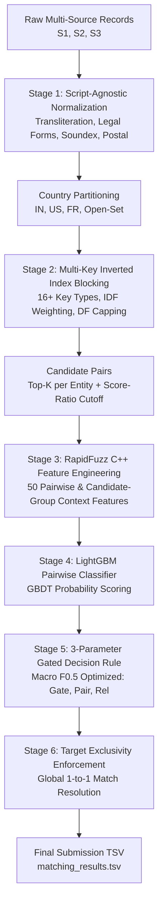

# Amazon ML Challenge 2026 — Business Entity Resolution

[](https://www.python.org/)
[](https://lightgbm.readthedocs.io/)
[](https://github.com/maxbachmann/RapidFuzz)
[](#local-validation-scorecard)
[](https://opensource.org/licenses/MIT)

An industrial-grade, scalable Machine Learning pipeline designed for the **Amazon ML Challenge 2026: Business Entity Resolution Challenge**. Given millions of commercial business records across 3 independent, noisy data sources, this pipeline links and resolves records to identify identical real-world business entities across multiple countries (India, US, France, and open-set test partitions).

---

## Architecture Overview



---

## Key Pipeline Components

### 1. Pre-processing & Open-Set Normalization (`src/er/preprocess.py`)
- **Unicode & Transliteration**: Unicode NFKD accent normalization, lowercase conversion, and punctuation stripping.
- **Phonetic Encoding**: Russell / American Soundex encoding of anchor brand tokens to bridge phonetic transliteration gaps (e.g., *Chandra* vs. *Chander*, *Laxmi* vs. *Lakshmi*, *Agarwal* vs. *Aggarwal*).
- **Open-Set Legal Form Canonicalization**: Standardizes legal suffixes across jurisdictions (US: `inc`, `corp`, `llc`; India: `pvt ltd`, `llp`, `opc`; France: `sarl`, `sas`, `eurl`, `sci`), with a union fallback for unseen test countries.
- **Prefix Honorific Stripping**: Cleans titles such as `Sri`, `Shree`, `Dr`, `M/s` to isolate the core brand name.
- **Postal Code Extraction**: Multi-pattern regex for India (6-digit PIN), US (5-digit ZIP), France (5-digit code), and general 4–6 digit codes.
- **Address Landmark Normalization**: Expands common abbreviations (`st` &rarr; `street`, `rd` &rarr; `road`, `opp` &rarr; `opposite`, `bldg` &rarr; `building`).

### 2. High-Recall Multi-Key Inverted Index Blocking (`src/er/blocking.py`)
- Country-partitioned inverted indexing using **16+ complementary key strategies**:
  - **Lexical**: Core tokens (`T`), Character 3-grams (`G`), Sorted core name (`N`).
  - **Compound**: Postal + Name Token (`PT`), Postal + Street Number (`PS`), Name + Postal (`NP`), Name + Locality (`NL`).
  - **Phonetic**: Soundex anchor keys (`PH`), Soundex + Locality (`PHT`).
  - **Brand Anchor**: First distinctive word (`ANC`), Anchor + Postal (`ANCP`).
- **DF Capping & Key Protection**: Capping high-frequency uninformative keys while strictly protecting compound keys to ensure true matches are retained.
- **Top-K & Score Ratio Pruning**: Retrieves top candidates per entity while dynamically dropping candidates with score ratio $s < \alpha \cdot s_{\max}$.

### 3. C++ Accelerated Feature Engineering (`src/er/features.py`)
Computes **50 pairwise and group-context similarity features** with multithreaded RapidFuzz:
- **String Similarities**: Levenshtein ratio, Token-Sort, Token-Set, Partial Ratio, Jaro-Winkler, Character 3-gram Jaccard.
- **Token IDF Coverage**: Directional token coverage ($S1 \rightarrow \text{Target}$ and $\text{Target} \rightarrow S1$), rarest shared token IDF, rarest missing token IDF.
- **Address & Location Signals**: Token-Sort, Token-Set, street number overlap/conflict flags, postal code match/prefix/conflict scoring (+1.0 exact, +0.5 prefix, -1.0 conflict, 0.0 missing).
- **Candidate-Group Context**: Similarity gap to top candidate, intra-group rank, group size.

### 4. LightGBM Matcher & Gated Decision Rule (`src/er/model.py`, `src/er/decision.py`)
- **LightGBM Classifier**: Lightweight binary GBDT (< 10 MB, strictly compliant with parameter rules) trained with early stopping on grouped held-out validation.
- **3-Parameter Gated Decision Rule**:
  - `gate` ($0.65$): If $\max(p) < \text{gate}$, predict **EMPTY**, securing a perfect 1.0 score on singletons.
  - `pair` ($0.20$): Acceptance threshold for candidate links.
  - `rel` ($0.72$): Relative threshold against top candidate confidence.
- **Target Exclusivity Enforcement**: Eliminates conflicting matches by assigning each target record only to its highest-confidence Source-1 entity.

---

## Engineering Highlights & Hardware Optimization

- **Ultra-Low Memory Footprint**: Strictly maintains RAM usage **under 1.5 GB** at all times through country sharding and chunked streaming execution (`s1_chunk = 20_000`).
- **Zero Heavy Dependencies**: Operates without heavy sentence transformers or bloated dense matrices, preventing memory exhaustion on large datasets.
- **Deterministic Execution**: Fixed random seed (`42`) across all components for full reproducibility.

---

## Local Validation Scorecard

Evaluated on held-out validation data optimizing the official competition metric (**Macro $F_{0.5}$**):

| Metric | Score | Note |
|---|---|---|
| **Macro $F_{0.5}$** | **0.8959** | Official competition evaluation metric |
| **Macro Precision** | **0.9424** | High precision weighting ($2\times$ over recall) |
| **Macro Recall** | **0.8144** | Balanced across multiple noisy sources |
| **Singleton Accuracy** | **91.60%** | Accurately identifies unlinked entities ($n=2,036$) |
| **Matched-Entity $F_{0.5}$** | **0.8947** | Performance on multi-source matched entities |
| **Blocking Recall Ceiling (@k=20)** | **84.67%** | Candidate pool coverage |
| **Single Global Threshold Baseline** | **0.8956** | Baseline comparison at $\tau = 0.74$ |

---

## Repository Structure

```text
├── code/
│   ├── business_entity_resolution/
│   │   ├── README.md                          # Inner module documentation
│   │   ├── requirements.txt                   # Dependency specifications
│   │   └── src/
│   │       ├── blocking.py                    # Multi-strategy candidate generation
│   │       ├── config.py                      # Hyperparameters & file configurations
│   │       ├── evaluate.py                    # Macro F0.5 evaluation metric
│   │       ├── features.py                    # RapidFuzz similarity feature extraction
│   │       ├── normalize.py                   # Parallel text normalization
│   │       ├── predict.py                     # Inference and submission output generator
│   │       ├── run_pipeline.py                # Master CLI execution pipeline
│   │       ├── train_matcher.py               # Model training & threshold tuning
│   │       └── er/                            # Modularized core package
│   │           ├── blocking.py
│   │           ├── data.py
│   │           ├── decision.py
│   │           ├── features.py
│   │           ├── model.py
│   │           ├── package.py
│   │           ├── pipeline.py
│   │           ├── preprocess.py
│   │           └── validate.py
├── artifacts/                                 # Trained model weights, alpha tables & curves
│   ├── alpha_table.csv
│   ├── importance.csv
│   ├── match_model.pkl                        # LightGBM trained weights
│   ├── per_country.csv
│   ├── recall_curve.csv
│   └── run_meta.json
├── student_resource/                          # Documentation templates & verification utilities
│   ├── Documentation_template.md
│   ├── README.md
│   └── utils/
│       └── validate_submission.py
├── Amritians_submission/                      # Formatted submission package
├── output/                                    # Generated matching predictions
│   └── matching_results.tsv
├── .gitignore                                 # Git configuration excluding >100MB files
└── README.md                                  # Root documentation (this file)
```

---

## Installation & Setup

1. **Clone the repository**:
   ```bash
   git clone https://github.com/AnnavarapuGanesh/amazon-ml-challenge.git
   cd amazon-ml-challenge
   ```

2. **Install dependencies**:
   ```bash
   pip install -r code/business_entity_resolution/requirements.txt
   ```

---

## Usage

### Running End-to-End Pipeline
Execute the master pipeline from the project root:

```bash
python code/business_entity_resolution/src/run_pipeline.py \
    --train-dir student_resource/dataset/train \
    --test-dir student_resource/dataset/test \
    --output-dir output \
    --team-name Amritians
```

### Validating Output Format
Verify that predictions conform to the official submission criteria:

```bash
python student_resource/utils/validate_submission.py \
    --submission-file output/matching_results.tsv
```

---

## License

This project is licensed under the [MIT License](LICENSE).
